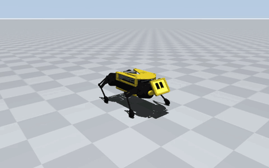
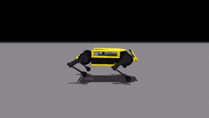
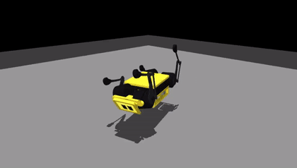

# Part 2. Meet the walker

In the last part we got everything installed. Now we're going to see a policy in action.

In this part we'll cover:

- Finding the policies, and checking that one is healthy
- Driving the walker around in a viewer
- Recording videos of it
- Choosing our own movements to record

As before, open a terminal and go to the folder we cloned:

```bash
cd ~/mini_pupper_4_rl
unset PYTHONPATH
```

## What's a policy, on disk?

The policies that run on the robot come with the code. Let's have a look at the walker:

```bash
ls mp4_rl/skills/walker/policies/sku2
```

You should see four files:

```
config.json  policy.npz  sku2_contract.json  sku2_joint_limits.json
```

- `policy.npz` is the policy itself, so the weights of its neural network. It's what decides how the legs move.
- `config.json` is a note of the settings it was trained with.
- The other two describe the robot it was made for, so how its motors are calibrated and how far its joints can move.

SKU2 is the Mini Pupper v4 with the long body and the Raspberry Pi. That's the one we'll be using all the way through.

Before we run it, there's a quick check we can do:

```bash
.venv/bin/python -m mp4_rl.deploy.runner check --policy mp4_rl/skills/walker/policies/sku2
```

A couple of things in that command will keep coming up, so let's break it down:

- `.venv/bin/python` is the copy of Python that the installer made for us, with all the right packages in it.
- `-m mp4_rl.deploy.runner` runs the program that drives the real robot. We're only asking it to `check` a policy, so it
  won't go looking for a robot.
- `--policy` is the folder we just looked at.

It prints eight lines. What we're looking for is plenty of `ok`, and no `FAIL`:

```
fixtures: max |numpy - torch| 3.40e-06 (ok, limit 3.38e-05)
calibration: ok (sku2_contract.json 86f1d330a9f3)
robot: ok (servo model md300, legs sku_2)
inputs: 450 (ok)
...
```

We'll come back to that first line in Part 5. The 450 inputs are the 45 numbers from [Chapter 0](../why/00_meet_the_robot.md#the-same-words-for-a-robot),
times the ten observations that the walker can look back on.

## Taking it for a drive

Time to see it move! We've got a small viewer for this, in a file called [`play.py`](play.py). Download it from that
link, then copy it into the folder that we're in and run it:

```bash
cp ~/Downloads/play.py .
.venv/bin/python play.py
```

A window should open with the robot standing in it. Click on the window, then press the up arrow a couple of times, and
off it goes.



*Walking, turning, and then a shove.*

| Key | What it does |
|---|---|
| Up, down | walk faster forward, or backward |
| Left, right | turn left or right |
| 6, 7 | walk to the left or right |
| Enter | stop |
| 8 | give it a shove |
| 9 | start again |

You can drag with the mouse to look around, and scroll to zoom. Meanwhile, the terminal shows what you've asked for, and
what the robot's actually doing:

```
asked: forward +0.10 left +0.00 m/s turn +0.5 rad/s | doing: +0.09 -0.00 +0.4
```

Notice that the two aren't quite the same. The policy's doing its best to follow the command, fifty times a second, and some
commands are easier than others. Have a play and see if you can find one that it struggles with. And don't hold back on
shoving it, that's what 9 is for.

When you're done, close the window.

> The viewer runs on your processor, so it doesn't need an NVIDIA card. If it's jerky, try adding `--simple` to the end,
> which swaps the robot for some plain shapes that are easier to draw. It looks worse, but the walking is the same.

## Recording a video

> **From here until the end of Part 4, you'll need an NVIDIA card to follow along.**

The viewer is nice for getting a feel for a policy, but it only shows us one robot, on a flat floor, in one particular simulated world. To judge
a policy we'd like to see how it does with lots of robots, each [a little bit different](../why/02_the_simulator_lies_a_little.md#training-on-lots-of-different-worlds), and
all asked to do the same movements. For that there's a script that puts the
policy through a set of tests in the same simulator it was trained in, and it can also record what happens:

```bash
VIDEOS=1 sh mp4_rl/skills/walker/eval/sku2.sh runs/look vid_side
```

- `VIDEOS=1` tells the script that we'd like it to record.
- `runs/look` is a new folder for the results. Everything we make will go into `runs`.
- `vid_side` is which test to run. This one's a view from the side.

It'll say `run vid_side`, and then nothing for a while. The first time took a bit over two minutes on our computer, since
the simulator has to get itself set up for your graphics card, and after that about a minute and a half. When it's finished
there'll be a video in `runs/look`, which you can open from your file manager, or like this:

```bash
xdg-open runs/look/omni_side.mp4
```



*The first four movements. It's asked for seven different movements, four seconds each.*

If it says `FAILED` instead, the reason will be at the end of `runs/look/vid_side.log`.

> If you run the same command again, you'll get `done vid_side` straight away. The script never repeats a test when the
> results are already there. That's handy, but it'll catch you out if you try a *different* policy with the same folder, as
> you'd be looking at the old one. So from here on, we'll use a new folder each time.

There's a second policy in there too, which gets the robot back up after a fall. We met it in
[Chapter 6](../why/06_getting_back_up.md), and we can watch it in just the same way:

```bash
VIDEOS=1 sh mp4_rl/skills/getup/eval/sku2.sh runs/look_getup vid_back
xdg-open runs/look_getup/getup_back.mp4
```



*Don't blink!*

## Choosing the movements

What if we'd like to see something else? Underneath, that script is running a Python program, and we can run it ourselves
with our own list of movements:

```bash
MUJOCO_GL=egl .venv/bin/python -m mp4_rl.skills.walker.eval.omni \
    --policy mp4_rl/skills/walker/policies/sku2 \
    --actuator md300 --supply-v 10.5 12.6 --masses-json sku2_masses.json \
    --camera 0.5 -10 90 \
    --video runs/mine.mp4 \
    --video-commands="0.20,0,0; 0,0,2.0; -0.10,0,0"
```

That's a long one, but there are only two lines that we need to care about. (The others say which policy, what the robot's motors and battery
are like, and where to put the camera.) `--video` is where to put the video, and
`--video-commands` is the list of movements, separated by semicolons. Each of them is three numbers:

- how fast to go forward, in metres per second (a minus sign means backward)
- how fast to go left (or right, with a minus)
- how fast to turn left, in radians per second (a full turn is a bit over six radians)

So this one walks forward as fast as it knows how, spins on the spot, and then backs away slowly. It prints a few warnings
along the way, which you can ignore. The video will be in `runs/mine.mp4`.

Try some movements of your own. The walker was trained to go up to 0.20 m/s in any direction and to turn on the spot at
up to 2.0 radians per second, so if you ask for more than that, you're on your own!

## Up next

So far we've been using a policy that somebody else trained. In [the next part](03_our_first_training.md) we'll start
training one ourselves.
