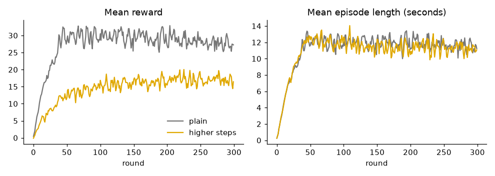
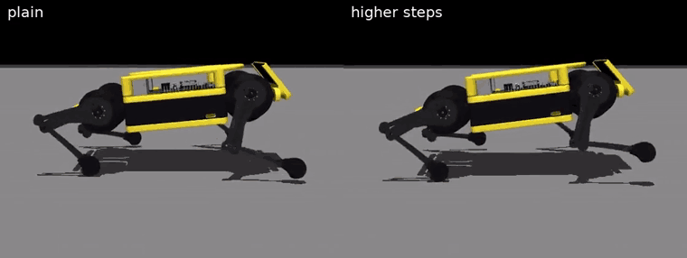
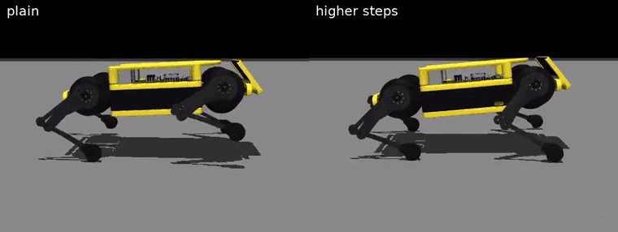

# Part 4. Changing one thing

> **You'll need an NVIDIA card for this part.**

In the last part we trained a walker using the recipe just as it was. Now we're going to ask for something a little different, and see what we get. We'll
cover:

- Finding the setting that we want to change
- Doing the same run again, with the change
- Comparing the two
- Why we didn't get *quite* what we asked for

## What shall we change?

Let's make the robot lift its feet higher. It's something we can see in a video, and it'd be useful too, since a robot that
[can't see where it's going](../why/04_one_step_at_a_time.md#helping-a-blind-robot) could do with a bit more room over the bumps.

There's a part of the reward for this already. Each time the robot takes a proper step, it looks at how high that foot got on the way. If it didn't make it to a
certain height, the robot loses some points, and the further it fell short, the more it loses. Two settings control it:

- `--clearance-target` is the height to aim for, in metres. Normally it's 0.025, so 25 millimetres.
- `--clearance-weight` is how much it matters. Normally it's -2, where the minus sign makes it a penalty.

You can spot the second one in the recipe. The first isn't in there, since the trainer uses 0.025 unless it's told otherwise:

```bash
grep -n clearance mp4_rl/skills/walker/recipes/sku2/step1.sh
```

Our first thought was to only change the target, and move it up to 45 millimetres. We tried that, and the feet only came up by a millimetre or so. So we'll make it matter more as well, by changing the weight to -6.

## The second run

Once the first run has finished, we can start the second. We don't need to edit the recipe. It'll take extra settings through something called `EXTRA`, and they override the ones it already had:

```bash
cd ~/mini_pupper_4_rl
unset PYTHONPATH
OUT=runs/high EXTRA="--clearance-target 0.045 --clearance-weight -6" \
    sh mp4_rl/skills/walker/recipes/sku2/step1.sh "" "" 300
```

Everything else is the same as before, including the seed. That's important, because if we'd changed five things, we wouldn't know which of them to blame.

While that's running (another quarter of an hour or so), you could have TensorBoard open again. This is what ours looked like:



*Our two runs. The climb at the beginning is mostly because the robots have only just been set going.*

The reward for the new run is a lot lower. Is that bad? Not by itself. We made one of the penalties bigger, so of course there's less left over. You can't compare the
reward of two runs that are being rewarded for different things. The length of the episodes, on the other hand, does mean the same in both, and there's hardly any difference. So
far, so good.

## Getting them ready to compare

A checkpoint has everything that's needed to carry on training. To use a policy, we only need the policy itself, so we **export** it. We'll come back to this in
the next part, but for now:

```bash
.venv/bin/python -m mp4_rl.common.export runs/plain/*/model_6596.pt runs/exports/plain
.venv/bin/python -m mp4_rl.common.export runs/high/*/model_6596.pt runs/exports/high
```

Each of those should print `EXPORTED`. The `*` stands for the name of the run's folder, which has the date in it, so we don't have to type it. If you've done the same
run twice there'll be two folders, and the command will complain. In that case, type out the one that you want.

## Looking at the numbers

Now we put both of them through the same test. It asks for 37 different movements (and standing still), and tries each of them on 24 robots:

```bash
WALKER=runs/exports/plain sh mp4_rl/skills/walker/eval/sku2.sh runs/eval_plain omni_s21
WALKER=runs/exports/high sh mp4_rl/skills/walker/eval/sku2.sh runs/eval_high omni_s21
```

`WALKER` is the policy to test. Notice that they've each got a folder of their own for the results. They took about a minute each for us.

The results are in a file called `omni_s21.log`. It's quite a big one, so let's just pick out the height of the feet while walking forward at 0.10 m/s:

```bash
grep -A1 "^  +0.100,+0.000,+0.00 " runs/eval_plain/omni_s21.log | grep -o "clearance_mm=[0-9.]*"
grep -A1 "^  +0.100,+0.000,+0.00 " runs/eval_high/omni_s21.log | grep -o "clearance_mm=[0-9.]*"
```

Those three numbers are the movement: forward, sideways, and turn. We got this:

```
clearance_mm=24.658
clearance_mm=30.734
```

So that's about 6 millimetres higher. It's nowhere near the 45 that we asked for, but it's a clear difference for a quarter of an hour's training. Is it just luck? We ran both of them
again with a [different seed](../why/03_you_get_what_you_reward.md#six-robots-learn-to-fall-over), and it was much the same, with 23 millimetres for the plain
run and 30 for the new one. Yours won't be exactly like ours, even with the same seed, but it should be something similar.



*Both walking forward at 0.10 m/s, at half speed. The plain one is on the left.*

## Job done?

Before we celebrate, there's a script that sums up how a policy did on all of the movements:

```bash
.venv/bin/python mp4_rl/skills/walker/eval/score.py runs/eval_plain
.venv/bin/python mp4_rl/skills/walker/eval/score.py runs/eval_high
```

It prints a table for each. Every movement has a target, which is to get to at least three quarters of what was asked for. Above the table, it says how many of them were met. Here are ours, plain
first:

```
28 of 37 commands meet their target
12 of 37 commands meet their target
```

Oh dear. If we look down the table for the new policy, there are a lot of lines that say `misses`, and this is one of them:

```
| vx m/s, vy m/s, wz rad/s | achieved | classic gait | target | |
| +0.00 +0.00 -1.00 | -0.00 | - | 0.75 | misses |
```

It's been asked to turn right on the spot at 1 radian per second, and it's doing nothing at all. Let's record that one:

```bash
MUJOCO_GL=egl .venv/bin/python -m mp4_rl.skills.walker.eval.omni \
    --policy runs/exports/high \
    --actuator md300 --supply-v 10.5 12.6 --masses-json sku2_masses.json \
    --camera 0.5 -10 90 \
    --video runs/high_turn.mp4 \
    --video-commands="0.10,0,0; 0,0,-1.0"
```



*Both have been asked to turn right on the spot. The plain one is on the left, and the one with higher steps is on the right.*

We asked for higher steps, and we got them, but along the way it's given up on turning right on the spot. It walks forward happily enough, but for quite a few of the
gentler movements it'd rather just stand there. Our second seed did it as well.

Why would it do that? Think about how the reward works. The robot loses points whenever it takes a step that wasn't high enough. If it's not very good at lifting its feet when it
turns, then each step costs it something, and we've just made that three times as expensive. One sure way of never stepping too low is not to step at all.
We haven't proved that's the reason, but we think it is.

If you've read [Chapter 3](../why/03_you_get_what_you_reward.md) of the other tutorial, this might sound awfully familiar. The robot that wouldn't step up is back!

Notice, too, that nothing in those graphs gave it away. The episodes were just as long. We only found out because we tested
each of the movements separately.

## Over to you

So how would you fix it? Here are a few ideas to get you started:

- Find some middle ground, like a weight of -3 or -4, or a target of 0.035.
- Make the anchor stronger, with something like `--beta0 10` (it's 5 at the moment). That might bring the turning back, though it may pull the feet back down too.
- Pay more for moving, with `--progress 4` (it's 2 at the moment). For this one, keep in mind that turning on the spot doesn't count as progress, so it may not do what you'd hope.

We haven't tried any of these, so you'll be finding out before us. Change one thing at a time, give each run its own `OUT` folder, and have a guess at what's going to happen before you look.

## Up next

In [Part 5](05_pack_it_up.md) we'll see what an exported policy is, check that ours are healthy, and drive them around.
