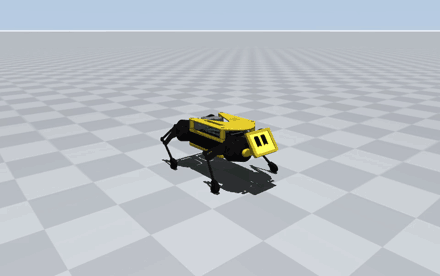

# Training the robot dog yourself

This is a step-by-step guide to the code behind the Mini Pupper v4's walking. We're going to install it, drive a policy
around in simulation, train one, change something about the training to see what happens, and check the result.

If you'd like the story behind it, and the reasons why things are done the way they are, that's in the
[other tutorial](../why/README.md). You don't need to have read it, but we'll point to the right chapter whenever it would
help.

## Parts

0. [Before we start](00_before_we_start.md): what you'll need, and which route to take
1. [Setting up](01_setting_up.md): getting the code and installing it
2. [Meet the walker](02_meet_the_walker.md): driving it around, and recording videos
3. [Our first training](03_our_first_training.md): starting a run, and making sense of what it prints
4. [Changing one thing](04_changing_one_thing.md): a small experiment
5. [Packing it up](05_pack_it_up.md): exporting a policy and checking it
6. [Where to go next](06_where_to_go_next.md): longer runs, other settings, and policies of your own
