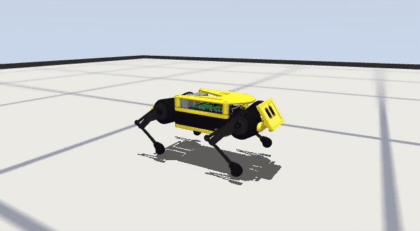
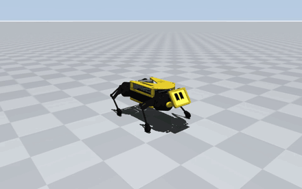

# Teaching a small robot dog to walk

Two tutorials about how the Mini Pupper v4 learned to walk, and to get back up, with reinforcement learning. Each one stands on its own, so start
with whichever suits you.

| | Tutorial | What it's about |
|---|---|---|
|  | [**Why it works**](why/README.md) | The story: what we tried, what went wrong along the way, and the ideas that came out of it. Reading only, no code. |
|  | [**How to do it yourself**](how/README.md) | A step-by-step guide to our public code: install it, drive a policy around, train one, change it and check it. Needs Linux, and an NVIDIA card for the training. |

If you'd like to read both, we'd suggest the story first. The guide then shows you where each idea lives in the code, and points back to the story along
the way.

All of the code is in [mini_pupper_4_rl](https://github.com/mangdangroboticsclub/mini_pupper_4_rl).

```{toctree}
:hidden:
:caption: Why it works

Introduction <why/README>
why/00_meet_the_robot
why/01_a_head_start
why/02_the_simulator_lies_a_little
why/03_you_get_what_you_reward
why/04_one_step_at_a_time
why/05_learning_without_forgetting
why/06_getting_back_up
why/07_onto_the_robot
```

```{toctree}
:hidden:
:caption: How to do it yourself

Introduction <how/README>
how/00_before_we_start
how/01_setting_up
how/02_meet_the_walker
how/03_our_first_training
how/04_changing_one_thing
how/05_pack_it_up
how/06_where_to_go_next
```
