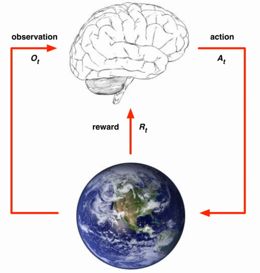
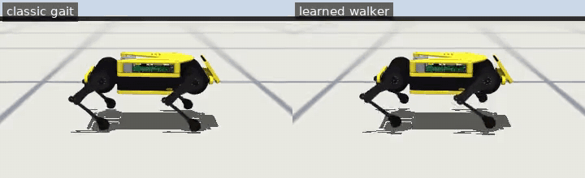
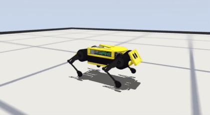

# Chapter 0. What is reinforcement learning?

Before we get to the robot, we're going to spend a few minutes on what reinforcement learning actually is. If you've
come across it before, feel free to skip ahead to [the robot](#now-lets-bring-in-the-robot).

## Learning to play a game

Imagine someone hands you a video game you've never seen before. There's no manual and nobody to explain the rules.
All you've got is a joystick, the screen, and a score in the corner.

So what do you do? You'd probably just start pushing the joystick around to see what happens. Most of the time,
nothing much. But every now and then the score goes up, and you think "ooh, what did I just do?" and try to do it
again. Play for long enough and you'll get pretty good, even though nobody ever told you how the game works.

That's reinforcement learning! It's learning by trial and error, with nothing but a score to tell you how you're
doing.

You may have heard of DeepMind's program that learned to play old Atari games, which did exactly this. It could see
the pixels on the screen and the score, and it could move the joystick, but it wasn't told anything about the rules.
They trained it on 50 different games, one at a time, and on almost half of them it got as good as a human player. If
you're curious, [DeepMind's post about it](https://deepmind.google/blog/deep-reinforcement-learning/) is a nice read.

| | |
|---|---|
|  |  |

*DeepMind's program playing Breakout and Space Invaders. Click on either one to watch it on Google DeepMind's YouTube channel.*

There are a few words that people use when they talk about this stuff, and it's worth getting them straight now since
we'll be using them all the way through. Sticking with our game:

- The **agent** is whoever is doing the learning. Here, that's the player.
- The **environment** is the world the agent is in, so the game itself.
- An **observation** is what the agent gets to see. For us, that's what's on the screen.
- An **action** is what the agent can do, which is moving the joystick.
- The **reward** is the score, telling the agent how well it's going.
- The **policy** is how the agent decides what to do, based on what it sees. You can think of it as the player's
  skill at the game.

*The agent (the brain) and its environment (the world). From Lecture 1 of [David Silver's reinforcement learning course](https://www.davidsilver.uk/teaching/), [CC BY-NC 4.0](https://creativecommons.org/licenses/by-nc/4.0/), resized.*

Put it all together, and we've got a loop. The agent observes something, picks an action, gets some reward, then
observes what happened and goes around again. Training is all about improving the policy, so that the reward adds up
to more and more.

## Now let's bring in the robot

Let's swap our game for a robot dog. The Mini Pupper v4 has four legs with three motors each: one to swing the leg
out sideways, one for the thigh, and one for the knee. That's twelve motors in total, and each one works the same way.
You give it an angle, and it tries to go there.

What can the robot sense? Not a lot, as it turns out. It can feel which way is down and how fast it's rotating, using
a chip called an **IMU** (there's one in your phone, which is how it knows when you've turned it sideways). And it
knows the angle of each of its joints. But that's it! The walking software has no camera, no sensors in the feet and
no map. When the robot comes to a step, it finds out the same way you would in the dark, by bumping into it.

To walk, something has to choose an angle for all twelve motors, and then do it again, fifty times every second. We'll
call each of those a **control step**.

We don't have to use reinforcement learning for this. The more traditional way is to sit down and work out the geometry
of the legs, then design a pattern of steps by hand. A pattern like that is called a **gait**, and the Mini Pupper
already comes with one, a **trot**, where diagonally opposite legs move together. We'll be seeing a lot of it, so we'll
give it a name: the **classic gait**.

*The classic gait, next to one of our learned walkers. They've both been asked to walk forward at the same speed.*

The classic gait does a good job on a flat floor. But what if somebody gives the robot a shove, or the ground is bumpy?
Those are all things that a person would have to think of ahead of time, and then program in. With reinforcement
learning we go about it the other way around. We describe what we'd like the robot to do, and leave it to figure out
how.

*Where this is all heading: a trained policy walking in simulation. There are more animations on the [walker's page](https://github.com/mangdangroboticsclub/mini_pupper_4_rl/blob/64021d25e2c31798e64d59916ecb94ed6aa60041/mp4_rl/skills/walker/README.md).*

## The same words, for a robot

So how do all those words from our game carry over?

Our agent is the robot, and its **observation** is a list of 45 numbers instead of a screen full of pixels. They are
the two things we just talked about, plus a couple of others:

| What | How many numbers |
|---|---|
| How fast the body is rotating | 3 |
| Which way is down | 3 |
| The command: how fast to go forward, sideways and turning | 3 |
| The angle of each joint | 12 |
| How fast each joint is moving | 12 |
| What the policy asked for last time | 12 |

The command is just us telling the robot where we'd like it to go, like you would with a remote control. The walker
also gets to look back at its last ten observations, which is about a fifth of a second, so it can tell how things are
changing.

The **action** is twelve numbers, one angle for each motor.

In between the two is the **policy**, which for us is a small **neural network**. Observations go in, actions come out, and
when we talk about training, all we really mean is updating the numbers inside it (its **weights**) so that better
actions come out.

Now here's the important bit, the **reward**. A video game comes with a score, but a robot doesn't, so we have to make
one up ourselves. For walking, the robot earns points mainly for moving and turning at the speed we asked for, and
loses a few for things we don't want, like bouncing up and down, wobbling, letting its feet slip, or wasting effort.

Notice that we never say anything about *how* to walk. There's no "lift your front left foot" in there. We only
describe the result, and it's up to the robot to find some way of moving that gets there. As we'll see, it doesn't
always find the one we had in mind!

Lastly, we need an **environment**. We could put the real robot on the floor and let it fall over again and again,
but it's much easier to use a **simulator**, which is a physics program with a model of the robot inside. We run 1,024
robots side by side in ours, and we'll talk more about that in Chapter 2.

## So what does training look like?

To begin with, all the weights are set at random, so the robot just twitches and falls over. To find something better, it
has to try new things, so we add a bit of randomness to every action. Whenever that happens to earn more reward, the
training algorithm adjusts the weights to make those actions a little more likely next time. Then we repeat that,
thousands of times.

The algorithm we use is called **PPO**. We won't be going into how it works, but there's a link at the end if you'd
like to dig deeper.

There are two more words we'll be using a lot. An **attempt** is one robot having one go, which ends when it falls
over, runs out of time or, if it's on some stairs, makes it off them. And a **round** is where all the robots act for a
moment, and then we update the policy.

With that many robots, each round gives us about eight minutes' worth of experience. So a thousand rounds is several
days of non-stop walking practice, which takes two or three hours on a gaming graphics card. Not bad!

## What could go wrong?

Put like that, it sounds pretty straightforward. We write down what we want, press start, and come back in a few hours
to a robot that walks. Sike! There are three problems that we kept on running into:

1. **It's hard to learn from nothing.** A robot that's twitching at random doesn't often stumble into walking. In
   Chapter 1 we'll give it a head start.
2. **The simulator isn't the real world.** A policy might be brilliant in simulation, then fall flat on its face on a
   real floor. That's Chapter 2.
3. **The robot does what we reward, and that's not always what we meant.** We'll see some examples of that in
   Chapter 3.

After that we'll move on to rougher ground, teaching new skills without losing the old ones, and getting back up after
a fall.

## Further reading

You won't need any of this for the rest of the tutorial, but if you'd like to know more about the theory, these are
good places to start:

- [Spinning Up in Deep RL: key concepts](https://spinningup.openai.com/en/latest/spinningup/rl_intro.html) covers the
  ideas in this chapter with a bit more detail.
- The [Hugging Face Deep RL Course](https://huggingface.co/learn/deep-rl-course/unit0/introduction) is free, starts
  from the very beginning, and has exercises.
- [Proximal Policy Optimization](https://spinningup.openai.com/en/latest/algorithms/ppo.html) explains what PPO is
  actually doing.

Next: [Chapter 1. A head start](01_a_head_start.md)
