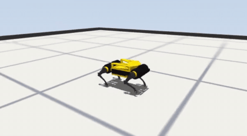

# Chapter 1. A head start

In this chapter we're going to get our robot walking on a flat floor. But before we set it loose with a random policy,
we'll have a look at why that tends not to go very well, and at a way of making it easier.

## The blank page problem

In the last chapter we said that the robot tries things at random and does more of whatever works. But what does
"trying things at random" actually look like on a robot?

Say you wanted to learn the piano, and your only method was to hit keys at random and wait for somebody to clap. You'd
be waiting a while! Nearly everything you play sounds equally terrible, so you never get a hint about which direction to
go in. Our robot's in the same boat. A random policy sends twelve random angles to twelve motors, fifty times a second,
so it shivers on the spot or tips over. Shivering in a slightly different way is no better.

*A policy that hasn't learned anything yet.*

This is the **exploration** problem. Before it can get better at walking, the robot has to stumble across something that's
at least a little bit like walking. Sometimes it does, but often it finds something easier first, like standing very
still, or shuffling along without lifting its feet. Either of those scores better than falling over, so once it's found
one, it tends to stay there.

So what if we didn't start from a blank page?

## Copying the teacher

We already have something that knows how to walk, the classic gait. It's not very clever, but it gets the job done. So
let's use it as a teacher.

Getting a network to copy a teacher is known as **imitation learning**, and the simplest kind, which is what we'll use, is
**behaviour cloning**. First we run the classic gait in simulation and write everything down. For each moment, what did
the robot sense, and what did the gait tell the motors to do? We ran 2,048 robots for ten seconds each, which gave us about
a million examples. Then we train the network to give the same answers as the teacher did.

There's no reward here, and no trial and error. It's the same sort of learning you'd use to recognise cats in photos,
except that instead of "cat" or "not cat", the right answer is twelve joint angles.

It worked really well. In simulation the network walked at 0.074 metres per second, compared to 0.076 for its teacher.

At this point you might be wondering what we've gained, since we had a gait that walks, and now we've got a network that
does the same thing slightly slower. The difference is that the network can keep learning.

## One step forward, all the steps back

So we took our cloned policy and switched on the reinforcement learning. In one of our first runs, we went back to look at
the policy after a single round of training, expecting it to walk about as well as before.

It couldn't walk at all! The weights had only moved by a percent or two, but the trot was gone.

To see what probably happened, we need one more piece of how PPO works. Along with the policy, we're also training a second
network called the **critic**. Its job is to look at the situation the robot is in and predict how much reward is coming.
If an action turns out better than the critic expected, the policy does more of it. If it turns out worse, it does less.

Can you see the problem? Our policy was already a decent walker, but the critic was brand new. It's a bit like having your
driving test marked by somebody who's never seen a car. Whatever they tell you to change, it's probably not going to help.

We did two things about it. For the first few dozen rounds, we only train the critic, so it gets to watch the robot walk
for a while before it starts handing out advice. And we made each change to the policy smaller, by lowering what's called
the **learning rate**.

After that, the policy came through its first real round still walking just like the clone. If you ever carry on training 
from a policy that works, and it suddenly doesn't, this would be a good place to start looking.

## Keeping hold of the trot

There was one other thing to look out for, which happens more slowly. Reinforcement learning cares about reward and nothing
else. If some kind of scruffy shuffle scores slightly higher than a nice tidy trot, then bit by bit, the trot will turn into
a shuffle.

To stop that happening we can use an **anchor**. We keep a frozen copy of the policy we started with, and as we train, we
compare what the new policy wants to do with what the frozen one would have done. The more they differ, the bigger the
penalty. The policy can still move away from where it started, but only if there's enough reward in it to be worth the
price.

So how strong should it be? We tried a few. With a very strong anchor hardly anything changed, so if the clone walked too
slowly, so did the trained policy. With a very weak one, some of the policies wandered off into a hurried little gait,
taking almost four steps a second where the teacher took fewer than three. Somewhere in between, they kept the look of the
trot and got most of the way to the speed we'd asked for.

There's no formula for this that we know of. We tried some values, watched the motions, and picked the one we liked. You'll
find that quite a lot of reinforcement learning goes that way.

## Trying it for real

Then it was time to put them on a real robot. We took six of our walkers, gave each of them three goes across the floor, and
none of them fell. Later we tried another six that had been trained with a lighter anchor, so they'd been free to wander a
bit further from their teacher. These ones were faster than the classic gait they'd learned from. In fact, they all went a
little faster than we'd asked them to!

## Takeaways

- Learning from nothing is hard, because at first there's nothing to tell the robot which way is better.
- If you've already got something that works, even something simple, you can clone it and improve it from there.
- A cloned policy can fall apart as soon as training starts. It helps to give the critic time to catch up, and to take
  small steps.
- An anchor lets a policy improve without losing what it was good at. It may take a few tries to find the right strength.

So far we've been saying "in simulation" as if it were no big deal. In the next chapter, we'll see what it takes for
something learned in there to work out here.
