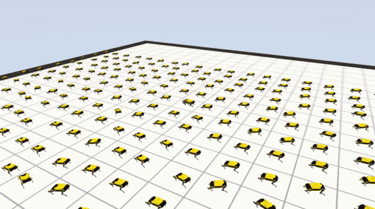
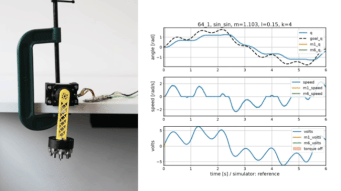

# Chapter 2. The simulator lies a little

The walkers in the last chapter learned everything they know in a simulator. In this chapter we're going to look at why
we'd want to do that, what goes wrong when we move to the real world, and a few things that we can do about it.

## Why not just use the robot?

If we want a robot to walk on a real floor, wouldn't it make sense to train it on a real floor? People do sometimes,
but there are a few good reasons why it's more common to use a simulator.

The first is that learning by trial and error involves an awful lot of error. A real robot that falls over thousands of
times is going to break, and then somebody has to fix it, which takes time and money. In a simulator, falling over is free.

The second is how much practice it needs. Remember that a thousand rounds of training is several days of non-stop walking.
With a single robot, that's several days of somebody picking it up and putting it back on its feet. In the simulator we
have 1,024 of them practising at once, and they can all be put back on their feet in an instant.

*Hundreds of simulated robots, all out for a walk at the same time.*

The third reason isn't quite so obvious. A simulator knows everything about its own world. How hard is the left front foot
pressing on the floor? Exactly how fast is the body moving? On the real robot we've got no way to measure those, but in
simulation we just look them up. The reward can use anything the simulator knows, even things that the robot itself will
never sense. This is called **privileged information**, and we'll find another good use for it in Chapter 4.

## What's the catch?

Let's say you learn to drive in a video game. You get pretty good, then you sit down in a real car. Plenty of it carries
over, but maybe the brakes in the game were a little too good. You'd find that out at the first red light.

It's the same for our robot. If the motors in the simulator are stronger than the real ones, it'll learn to count on
that strength, and then one day the strength isn't there. The policy doesn't know that it's in a simulator, so it learns
the mistakes along with everything else.

The difference between the two worlds is called the **sim-to-real gap**. For the rest of this chapter we'll look at ways to
make it smaller.

## Getting the motors right

On a small legged robot, one of the biggest sources of trouble is the motors. In a simulator, a motor is often treated like
a spring. You ask for an angle, and it pulls the joint towards it, harder the further away it is.

Real ones are a bit messier than that. There's a limit to how hard they can push, and it gets lower as they spin
faster. There's friction in the gearbox. And everything takes a little while, from reading the sensor to sending the command.
When a robot is walking, its legs are moving quickly with its whole weight on them, so all of these matter at once.

So instead of guessing, we measured them. It's a process called **system identification**, and the idea is fairly simple:

1. Put a real motor through a set of movements, and record what it does.
2. Build a model of the motor, leaving some blanks for the things we don't know, like how strong it is or how much
   friction it has.
3. Let a computer search for the values that make the model move the way the real motor did.

*One of our motors being put through its paces, next to what the real motor did and what our models predicted. From the [mini_pupper](https://github.com/mangdangroboticsclub/mini_pupper) repository, Apache-2.0.*

Then we put that model into the simulator, in place of the spring.

It helps a lot if the hardware is easy to measure in the first place. Our earlier robot, the Mini Pupper 2, used ordinary
hobby servos that report their position quite coarsely, and it took around a tenth of a second for a command to show up in
the readings. The motors on the v4 are quicker, report more finely, and come off the robot so that we can test them by
themselves.

## Late and noisy

There are two more differences to deal with, and these ones aren't about the motors.

The first is **delay**. On a real robot it takes a few milliseconds for the policy to get the sensor readings, decide what to
do, and have the motors respond. If it's never had to deal with that in training, it'll be reacting to things that have
already changed, a bit like talking to someone over a bad phone line. So in our simulator we hold each command back
for a moment. The amount is different for each attempt, anywhere between 8 and 19 milliseconds, so that the policy gets used
to all of it.

The second is **noise**. The simulator's sensors are perfect and real ones jitter, so we recorded the real robot's sensors
and added a similar amount of jitter to the simulated ones.

## Training on lots of different worlds

Some things we can't measure, or they change from one day to the next. How slippery is the floor? How full is the battery?
Is the motor on this robot a little weaker than the one we tested?

Rather than trying to pick the right answer, we can train on all of them. We give every simulated robot a slightly different
world to live in, which is called **domain randomisation**. Here are some of the things we change:

| What changes | How much |
|---|---|
| Grip between the feet and the floor | from quite slippery to very grippy |
| How soft the foot contact is | by a factor of four |
| Battery voltage | 10.5 to 12.6 volts, flat to full |
| Electrical resistance of the motors | 5 percent lower to 15 percent higher |
| Weight of the body | 10 percent lighter to 10 percent heavier |
| Delay | 8 to 19 milliseconds |

Since the robot never knows which of these worlds it's in, it needs to find a way of walking that does okay in all of them.
The hope is that the real world will be somewhere in the mix.

It's tempting to randomise everything and by a lot, but that comes at a price. A policy that has to be ready for anything
tends to be cautious about everything. So we try to measure what we can, and randomise the rest.

Even after all of that, the gap never goes away completely, and our real robot still walks a bit slower than the simulated
one. But that's okay! The simulator doesn't have to be perfect, it just needs to be close enough that what works in there
has a good chance of working out here.

## Takeaways

- Simulators make it possible to practise at a scale, and with a number of falls, that a real robot couldn't cope with.
- They also know things that a robot can't sense, which we can use during training.
- A policy learns the simulator's mistakes too, so it's worth measuring the things that matter. For us, that started with
  the motors.
- For things we can't measure, we can train on a range of possibilities.

Next: [Chapter 3. You get what you reward](03_you_get_what_you_reward.md)
