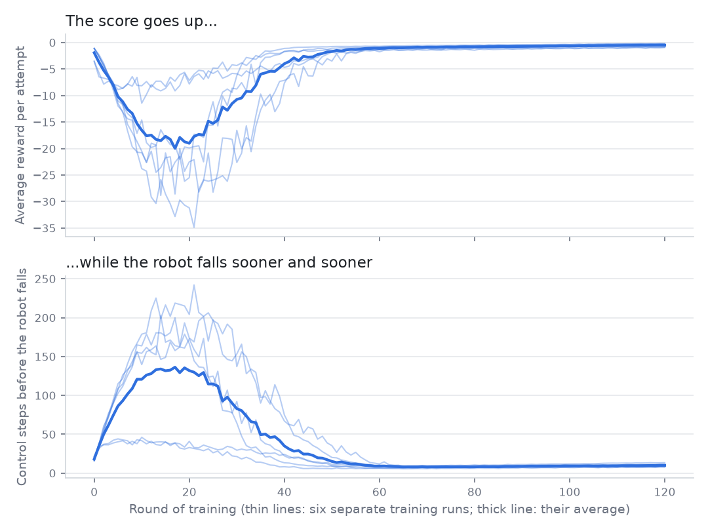
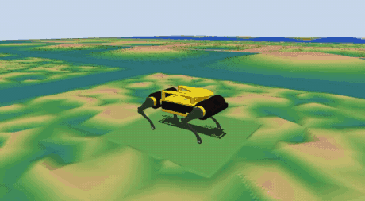
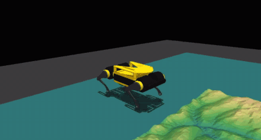

# Chapter 3. You get what you reward

Our robot can walk on a flat floor, so let's try something harder. In this chapter we're going to take it onto uneven
ground, and find out what happens when the reward doesn't say quite what we meant.

## Six robots learn to fall over

We built some bumpy ground in the simulator, and as a first experiment we wanted to know how far the robot could get without
a head start. So we set off six training runs from nothing: three slightly different setups, and two runs of each.

Why two of each? There's a fair bit of luck involved in training. The weights start off random, the robots are given
random commands, and they try random things. All of those random choices come from one number called the **seed**, so if you
change the seed you get a different run, even when everything else is the same. If two runs with different seeds agree, we
can be a bit more confident that it wasn't just luck.

The main thing that people watch during training is the **average reward**, which is the reward added up over an attempt. If
it's going up, then the robot's getting better at what you asked for. Ours dipped at the start, but then it began to
climb, and by round sixty all six were looking good.

Then we checked how long the robots were staying on their feet.

*All six runs, over the first 120 rounds.*

Early on, four of them were managing three or four seconds. By round sixty, every single one was falling over in about a
fifth of a second. They hadn't failed to learn how to walk. They'd learned to throw themselves on the floor.

*One of the six after a hundred rounds, slowed down to a quarter of its real speed.*

So what's going on? On this kind of ground, the penalties in our reward added up to more than the robot was earning. Every
moment that it stayed standing, its total went down a little. There was one penalty in particular, for turning away from the
direction it was meant to be facing, that kept on growing for as long as the attempt went on.

We could put some numbers to it, since we had a couple of other runs in the same experiment that had been given a head
start and could walk. A robot that walked for the whole attempt ended up with about −38 points. One that fell straight away got
about −1, simply because it was over before it could lose any more. So from the robot's point of view, falling was the better
choice. It wasn't a bug in the training. It was doing what our reward asked for, and we hadn't noticed what we were asking.

It also taught us to be a bit careful with that reward curve. When the reward goes up, it means that the robot is getting
better at collecting reward, and that isn't always the same as getting better at the task. These days, we'll also keep an
eye on something we can understand directly, like how long the robot stays up, or just a video of what it's doing.

## The robot that wouldn't step up

The fix seemed obvious enough. We'd give the robot a small bonus for every moment that it stays up, and a penalty for falling.
And rather than punishing it for drifting off course, we added a simple bit of steering that turns it back the right way.

This worked! A new run from nothing still spent its first hundred rounds falling over, but then it found its feet and
started walking. Another run that began with our flat-floor walker did even better, and got across gentle bumps and
slopes without any trouble.

So we gave it a proper test. Still in simulation, we put down an **uneven terrain zone**: a patch of random bumps, raised a
centimetre or two above the floor around it, so the robot has to step up to get onto it.

*The robot reaches the edge of the uneven terrain zone, and that's as far as it goes.*

It walked right up to the edge, and stopped. And then it just stood there, perfectly balanced, until the time ran out. It did
this almost every time.

Let's look at it from the robot's side again. By standing still, it's earning the bonus for staying up. It's even earning some
of the reward for matching our commanded speed, because we were asking it to go slowly, and zero isn't all that far from slow.
If it tries to step up, on the other hand, it might fall, and the penalty for that was worth about two seconds' worth of bonus.
So why would it take the risk? Our best guess is that we'd accidentally taught it that the safest thing to do was wait.

First we made it expensive to stay up, so it fell over. Then we paid it to stay up, and it stopped trying anything else!

## Paying for what we actually wanted

What we wanted the whole time was for the robot to get somewhere. So we added a term to the reward that pays for **progress**,
which is how much of the commanded speed the robot is really achieving in the direction that we asked for. You don't earn any
of that by standing around.

The best of our next policies got across the uneven terrain zone nearly every time. We should say that we changed quite a few other things
at once, so progress can't take all the credit. But when we paid for staying up without paying for progress, the robot
was still inclined to slow down and stall. With progress added, it wasn't.

It's a pattern we've run into again and again. When we reward a stand-in for what we want, like staying up, the robot will
happily give us the stand-in. It works better to pay for the thing itself, as directly as we can.

## Takeaways

- The robot learns whatever scores best with the reward you wrote, which might not be what you had in mind.
- A rising reward doesn't always mean it's getting better at the task, so it's good to have another measurement to check.
- Training involves some luck. Running the same thing with another seed gives you an idea of how much.
- Where you can, reward the thing you actually want, rather than something that usually goes along with it.

Next: [Chapter 4. One step at a time](04_one_step_at_a_time.md)
