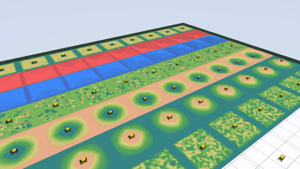
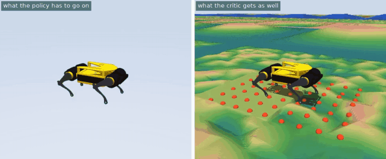
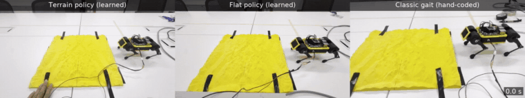
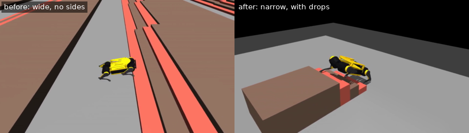

# Chapter 4. One step at a time

In the last chapter we fixed our reward so that the robot had a reason to keep moving. Now we're going to look at how it
learns to handle difficult ground, and then take it out of the simulator and see how it does.

## Walking in the dark

Let's remind ourselves what the robot can sense: which way is down, how fast it's rotating, and the angles of its joints.
That's it. So crossing rough ground is a lot like going up an unfamiliar staircase with your eyes closed and a thick
pair of boots on. You can do it, but you'd lift your feet higher than usual, and you'd have to notice when your toe hits
something.

A policy that's only ever walked on a flat floor does neither of those. It skims its feet just above the ground, since lifting
them takes effort and it's never had a reason to. If you put a small step in front of it, it mostly walks straight into it
and stays there, legs still going.

## Starting easy

We'd like it to practise on rough ground, then. But if we drop a beginner onto the hardest terrain we have, it'll fall
over straight away, every time, and it won't learn very much.

The way around that is the same as in any school: start with something easy and make it harder as you improve. In
reinforcement learning it's called a **curriculum**.

Ours is a big grid of practice areas. Going one way, we've got different kinds of ground: flat floor, bumps, slopes, scattered
blocks, steps and staircases. Going the other way, each of them gets harder over ten levels, so the bumps get bigger and
the steps get taller.

*Part of the grid. Each strip is a different kind of ground, which gets harder as you go along it.*

At the end of each attempt, we decide where the robot goes next. If it walked far enough without falling, it moves up a level. If
it fell, or got less than half as far as we'd asked, it goes back down. On stairs it has to actually get off the staircase to
move up, because otherwise it might find it can earn a promotion by wandering around at the bottom (there's that lesson from the
last chapter again!).

The nice thing about this is that nobody has to plan the lessons. Each robot keeps moving up until it starts to struggle, so
they all end up practising at around the level that's right for them.

## Helping a blind robot

Practising at the right level gets us a long way, but there are a few other things we did that are worth a look.

The first is to give the robot **a bit of memory**. If all it knows is where its legs are right now, it can't tell whether a leg
is on its way forward or has been stopped halfway by a step. If it can look back over its last ten observations, it
can. We tested this on some practice steps in simulation. Policies with no memory got up about 42 percent of the time, and the
ones that remembered got up 56 percent of the time. That's not bad for a fifth of a second!

We also gave it **a reason to lift its feet**, by rewarding it for lifting each foot clear as it swings, and taking a little away
when a foot stubs against something.

The last one is our favourite. The robot has to be blind, because the real one is. But do you remember the critic from Chapter 1,
the network that predicts how much reward is coming? It's only there to help with training. So there's nothing to stop us from
**letting the critic see**. We let it know the height of the ground around the robot and underneath each of its feet, all of
which is privileged information that the simulator can just look up. The robot still has to feel its own way, but the one giving
it advice can see the step coming.

*The same few seconds, twice. The policy only knows what its own body is doing. The critic also gets the height of the ground at points like these.*

When training is finished, we don't need the critic anymore, and we throw it away along with all of that extra information.
That's just as well, since the real robot has no way of getting it. The only thing that goes onto the robot is the policy.

## Taking it outside

Now for the real thing. We built an uneven terrain zone like the one in our simulator, put the real robot in front of it,
and gave it twenty seconds to get across and out the other side without falling over or wandering off the edge. Three different
walkers had a go: one of our early walkers that had trained on rough ground, another one that had only trained on a flat floor, and
the classic gait.

| Walker | Made it across |
|---|---|
| Trained on rough ground | 6 out of 8 |
| Trained on a flat floor only | 0 out of 8 |
| Classic gait | 0 out of 4 |

*The real thing, at twice the speed. From left to right: trained on rough ground, trained on a flat floor, and the classic gait.*

The flat-floor walker and the classic gait did pretty much what we described at the start of the chapter. Nearly every time, they got
to the edge and got stuck there. The one that had trained on rough ground climbed on and kept going. When it did miss, it was
because it had wandered over the side line on its way across.

## The missing edges

Next we tried stairs. Our best stair climber almost never failed in the simulator, so we had high hopes when we put it in
front of a real staircase. It was a small one, only a bit wider than the robot itself, and the steps were pretty steep for
something that size.

It didn't make it to the top once. Its front feet would get up a few steps, then one of its feet would catch on the edge of a step
and swing the whole robot around. Now it's pointing sideways on a narrow staircase, so it walks straight off the side.

So why had we never seen that in simulation? When we went back and looked, the answer was right there. The simulated stairs were many
times wider than the robot, and they didn't have any sides to fall off. If it got knocked around in there, it just carried on
climbing at an angle.

In Chapter 2 we worked hard on the robot in our simulator, so that its motors and its sensors behaved like the real ones. This time the
robot wasn't the problem. It was the world we'd put it in, which had never shown it what a narrow staircase is like.

So we rebuilt the practice stairs to be narrow, with a drop on each side, and counted it as a failure if the robot stepped off.
When we went back to the real thing with the retrained walker, it did make it to the top, though still not every time.

*The practice stairs, before and after.*

## Takeaways

- A curriculum lets each robot practise at a level that suits it.
- Robots that can't see can still get over rough ground. Some memory helped ours, and so did a reason to lift its feet.
- The critic is only used in training, so it's allowed to know things that the robot never will.
- When the real robot fails in a way you never saw in simulation, ask what's missing from the simulated world.

Our robot can now climb stairs, which is great. Unfortunately, when we asked it to walk backwards, it just stood there.

Next: [Chapter 5. Learning without forgetting](05_learning_without_forgetting.md)
