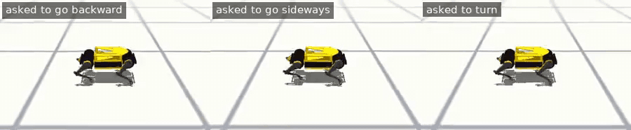
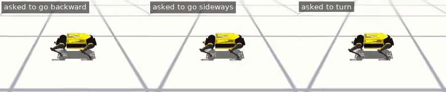

# Chapter 5. Learning without forgetting

In the last chapter we taught our robot to climb stairs. In this one, we're going to find out what it forgot while it
was learning that, and look at how we can add new skills to a policy while still keeping the old ones.

## Where did the rest of it go?

Let's go back to the commands for a moment. When we drive the robot around, we're telling it three things: how fast to
go forward, how fast to go sideways, and how fast to turn. Before it had ever seen a staircase our walker could do all
of those, including walking backwards and turning on the spot.

After all the training on uneven ground and stairs, we checked whether it still could. We had a list of twenty
different commands to try in simulation, and it passed three of them: walking forward slowly, walking forward slightly
less slowly, and standing still. For all the others, it either stood there or walked straight ahead, no matter what we
asked for.

*The stair specialist, asked for three things it used to know.*

So what happened? To keep things simple while it was learning the stairs, we'd only ever asked the robot to go
forward, and that turned out to be the problem.

Imagine that you speak French, and then you move to Spain for a few years and only ever speak Spanish. When you go back
to France you might be a bit rusty, but you'd still be able to get by. A neural network has it much worse. There's no
separate part of it where the French is kept. Learning Spanish means adjusting the very same weights that the French was
stored in, and if we never ask it to speak any French, there's nothing to stop them from being overwritten.

This is called **catastrophic forgetting**, and it's a common problem with neural networks.

## Getting it back

The obvious thing to do is to keep practising. If the robot forgot how to walk backwards because we stopped asking for
it, let's start asking again! So we took our stair climber and trained it some more, this time with all the different
commands mixed in. And after 800 rounds, it still couldn't do any of the ones it had lost.

It seems that the practice on its own wasn't enough. By then the old skills were probably gone, so the robot would have
had to learn them from scratch, and all while it already had something else that was earning it plenty of reward.

What it needed was a bit of help from someone who hadn't forgotten. If you were trying to get your French back, you'd
find a friend who speaks it, right? We happened to have one of those: an earlier walker that
could still go in every direction.

You might remember the anchor from Chapter 1, where we added a small penalty whenever the policy drifted too far away
from a walker that we trusted. We can use the same trick here. While the robot practises stairs, the anchor keeps
nudging it towards whatever that walker would have done.

How hard should it nudge? If we let the anchor fade away during training, the skills we'd got back faded away with it.
With a strong anchor all the directions came back, but the stair climbing seemed to suffer. What worked better was to
carry on from there with a weaker anchor. That way the robot kept its directions, and some of the climbing came back
too.

*The same three commands, after training with the anchor.*

The walker that we released grew out of this one, and it's a bit of a compromise. It can do a bit of everything, but if
all you want is to climb stairs, the specialist was better at it.

When we train it now we use both of these ideas together. It practises every kind of command, so nothing goes unused.
And it's anchored to the walker that we started with, but only for the commands that walker already knew. If we ask for
something new, like walking faster, the anchor lets go and the robot is free to work it out for itself.

## What if the robot changes?

There's one more situation where we'd like to hang on to what a policy already knows.

A policy is trained for one robot, and robots have a habit of changing. Maybe you swap in a different battery or add
something heavy on top. Maybe you measure the motors again and find your model of them wasn't quite right. Or maybe the
robot stays the same, but now you'd like it to go faster. Either way, the policy you've got may not be such a good fit
anymore.

Do we have to throw it away and start again? Well, think about what happens when you borrow a friend's car. The pedals
feel a bit different and it's wider than you're used to, but you don't go back and take driving lessons. You drive it
around for a while until you get the feel of it.

We can do the same with a policy. We take the one we have, put it in the updated simulation, and carry on training from
there. That's called **fine-tuning**. The robot already knows how to walk, so it only needs to learn what's different.

We did this ourselves when our model of the robot changed and, at the same time, we wanted it to walk and turn faster.
We kept the walker we had and trained it through four more stages of a few hours each, with the anchor on. After each
stage we'd see what it was still struggling with, and work on that in the next one.

## Takeaways

- A neural network can lose skills that it isn't practising, even ones it was good at.
- Once they're gone, mixing the old tasks back in may not be enough to recover them.
- An anchor to an earlier policy can help to keep the old skills while the robot learns new ones.
- If the robot or the task changes, try fine-tuning the policy you have before starting from nothing.

Next: [Chapter 6. Getting back up](06_getting_back_up.md)
