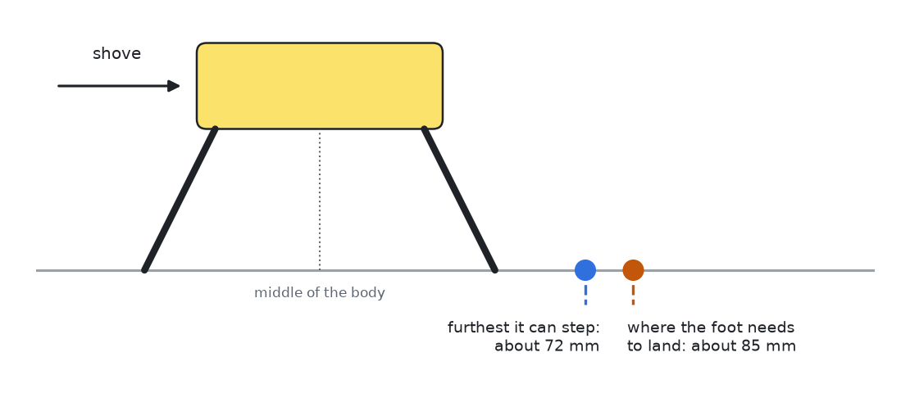
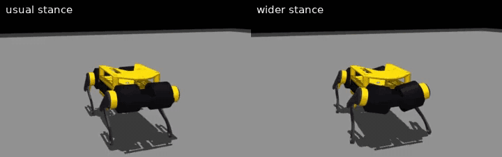
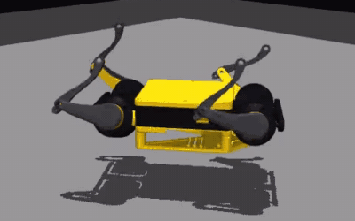
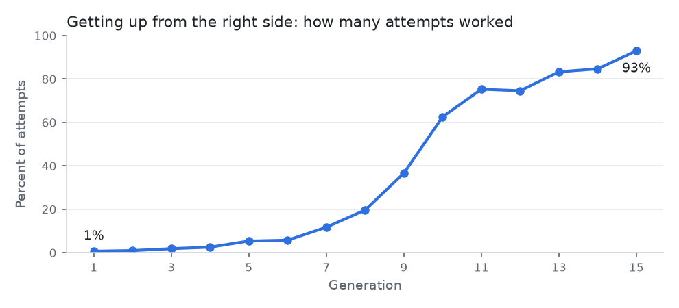
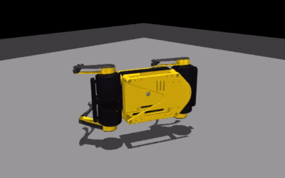
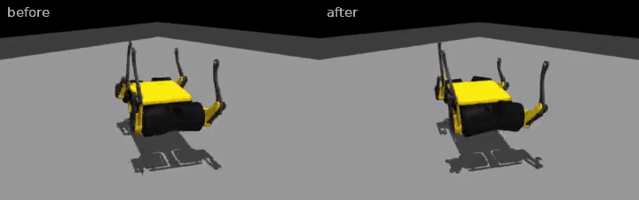
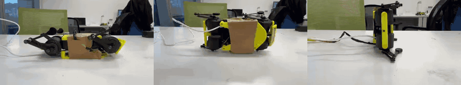
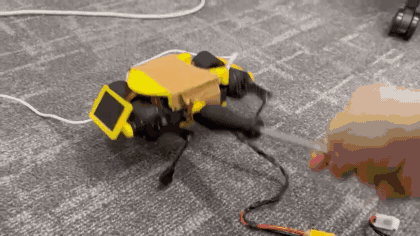

# Chapter 6. Getting back up

Our robot can walk in every direction and handle rough ground. But if you give it a good push from the side, it still falls
over, and once it's down there, it stays there until somebody comes along to pick it up. In this chapter we're going to fix that.

There are really two parts to it. We'd like the robot to fall over less often, and when it does fall, we'd like it to get back up.

## First, do the sums

To start with, we thought that falling less often was just a matter of more training. We'd add some random shoves, and the robot
would learn to brace itself and take a step, just like you would if someone bumped into you.

So we ran two big sets of training runs, and it barely made any difference. When we shoved the robot sideways at one metre per
second, it still fell about nine times out of ten.

Then we did a calculation that we should've done at the beginning. When something gets pushed, there's a point on the ground
where it needs to put its foot in order to stop itself from toppling. It's known as the **capture point**, and the harder the push,
the further away it is. For a robot of this height, with that kind of shove, it's about 85 millimetres out to the side. How far can
our robot step? About 72.

It didn't matter how much we trained it, because its legs couldn't reach!

*A sketch of the robot from the front, being shoved from the left.*

So we changed the way it stands. We took the same walker, without any retraining, and angled its legs outwards by another 12 degrees.
Now with the same sideways shove it fell one time in twenty, or less. The wider stance makes it slightly worse at climbing over
blocks, but we were happy with that trade, and our walkers have used it ever since.

*The same walker and the same shove. Only the stance is different.*

We'd spent about ten hours of graphics card time trying to learn something that a change in posture gave us almost for free. Now
we try to ask, before we train something, if it's physically possible, and whether there might be an easier way to get it.

## The move nobody could find

Of course, if you shove it hard enough it'll still go over. So now we need to teach it how to get up, and that turns out to be quite
a different problem to walking.

With walking, you can get better a little bit at a time. A slightly better step gets you slightly more reward. Getting up off your back
isn't like that. You need to tuck your legs in, roll over, plant your feet and push, and if you get the first three perfect but mess up
the last one, you're still lying on the floor. The chances of doing all of that by accident are tiny, and until it happens, there isn't
much for the robot to learn from.

We had a go at it anyway. We gave it a reward for being upright, set the policy to random, and started training. After nearly a thousand
rounds, it hadn't gotten up a single time. Meanwhile the randomness that training adds to its movements
kept on growing, until it was doing little more than twitching. We also tried over a dozen shorter runs with different settings, but none of them
could get up from lying on their side either.

*After nearly a thousand rounds of trying.*

This is the blank page problem from Chapter 1, only much worse. And this time there was no teacher for us to copy.

## Making our own teacher

So we made one!

If you think about it, a get-up is really just a few poses in a row. Tuck, roll, plant, stand. So rather than choosing an action fifty
times a second, what if we only had to choose about five poses, and how long to hold each of them?

A pose is an angle for each of the twelve motors, and then there's the holding time, so that makes thirteen numbers per pose. With
five poses, a whole get-up comes down to 65 numbers, and then the robot just goes to its standing pose. It makes a huge difference. When
we tried sequences of poses completely at random, one or two in every hundred seemed to roll the robot over from its side. That's still
a terrible way to get up, but it's a lot better than never!

Now we need to turn one in a hundred into something reliable, which we did with a search called the
**[cross-entropy method](https://en.wikipedia.org/wiki/Cross-entropy_method)**. The name sounds complicated, but what it does is
surprisingly simple:

1. **Guess.** Make up 64 sequences. For each of the 65 numbers we have our current best guess and how unsure we are about it, and we draw
   randomly around that. To begin with we're very unsure, so the sequences are all over the place. We also throw in a few of the lucky
   ones from before.
2. **Test.** Play each sequence on 16 simulated robots, which all have slightly different weights, friction and starting positions. Its score
   is how many of them make it to standing and hold it for half a second, with a small amount taken off for straining the motors.
3. **Keep the best.** Take the top 8 and throw the rest away.
4. **Update.** Our new best guess is, more or less, the average of those 8. Where they agree on a number, we become more sure of it, and
   where they don't, we stay unsure.

Then we go back to step 1 and do it all again. Each time around, the guesses bunch up a little closer to what works. When we searched
for a way to get up from the right side, about 1 percent of the attempts worked in the first generation. After 15 of them, it was over 90
percent.

*Every generation's 64 sequences, each tried on 16 robots.*

There's no neural network here, and nothing to say which way to change each number. It's just guessing, only we get better at
guessing as we go. In well under an hour for each starting position, it had found a way to get up from the left side, from the right
side and from lying on its nose, each of which worked almost every time.

*One of the get-ups that the search found.*

The trouble with a fixed list of poses is that it plays out exactly the same way no matter what's happening to the robot. What we
want is something that can react. Luckily, we already know how to do that from Chapter 1. We clone it into a network, and then use
reinforcement learning to improve it.

There was one thing we had to add. As it rolls over, the robot goes through the same position at different times and has to do something
different each time, so it needs to know how far along it is. We gave it a clock that counts from 0 to 1 over four seconds, which is
called a **phase**. Without it, the cloned policy got up about one time in twenty. With it, that went up to more than half the time from two
of the starting positions, and reinforcement learning took the best of those to over nine in ten.

That last part had to be done quite gently. Remember that reinforcement learning adds some randomness to every action. The usual
amount was enough to shake such a delicate movement to pieces before it could learn anything, so we turned it way down.

### The stubborn one

There was one position that none of this worked for: flat on its back. The search found nothing.

What worked in the end was a bit roundabout. In the simulator, we temporarily let the joints bend further than the real ones can. With that
extra freedom, training found a move that worked from *every* starting position: a compact backwards flip. Then we brought the limits
back towards the real values, in steps, and kept training, and over several more stages the policy squeezed the same idea into the
space it really had.

Loosening a problem until it becomes solvable, then tightening it again while holding on to the solution, is the curriculum of Chapter 4
applied to the rules instead of the terrain.

## Not so fast

Getting up is a pretty extreme movement. The joints go all the way to the ends of their range and the motors work as hard as they
can. That makes it a good way of finding out what you've missed, and we'd missed three things.

**Legs that bend too far.** The first get-ups that the search found weren't possible on the real robot, because the legs swung out
sideways a lot further than real legs can go. Our simulated robot knew how long its legs were, but not what they bump into. Later on, we had
another one that worked 99 times out of 100 in simulation, and could hardly ever flip over on the real robot. It needed one of its
hips to swing back much further than the real one does. When we put the real limit into the simulator, its score dropped
from 99 to about 20.

**A test that was too easy.** We'd been testing our get-ups by placing the simulated robot on the floor and counting how often
it got up, which was at least 94 percent of the time. But that's not how it's going to be used! So we tried the whole thing, where the
robot's walking along, gets shoved, takes a tumble, and then has to get up. Now it only worked between 18 and 43 percent of the time.

It turns out that after a shove, the robot's still rolling when the clock starts. So it'd miss its first try, and by that point the clock
had run out and it never tried again. We let the clock restart, and gave it some practice starting in the middle of a fall.

**The shakes.** Our get-ups worked, but they weren't much to look at. Every joint was trembling, changing direction around ten times
a second, and that's hard on the motors. We tried raising the penalty for jerky movements by 25 times, and then 50, and saw hardly any
change.

What did work was putting a filter between the policy and the motors, which smooths out any sudden changes. It has to be there
during training, though. If you add it to a policy that's already finished, it breaks it, because the policy's used to having its commands
followed straight away. We also asked the network itself to be smoother, so if two observations are nearly the same, the actions
should be too.

*Getting up from its back, before smoothing and after.*

## Both together

Finally, we put the walker and the get-up onto the robot together. There's a small piece of ordinary code that watches the IMU and
decides whose turn it is. If the robot leans over by more than 60 degrees for a third of a second, the get-up takes over. Once it's
upright and has been still for half a second, the walker gets the controls back.

Then came the fun part. We laid it on its back, on each side and on its nose, and it got up every time. And when we pushed it over,
it was usually back on its feet in around two seconds.

*On the real robot: from its back, from its right and from its left.*

*And after a good push.*

## Takeaways

- Check whether something's physically possible before you try to train it.
- If a movement only pays off at the very end, a robot probably won't find it by chance. You can find a rough version some other way, then
  let it learn from that.
- A clock can help if the policy needs to know how far through a movement it is.
- Make sure the simulated robot can't do things that the real one can't.
- Test a skill in the way that it'll really be used.
- Not everything has to be solved with the reward. Sometimes it's easier to change the system around it.

Next: [Chapter 7. Onto the robot, and beyond](07_onto_the_robot.md)
