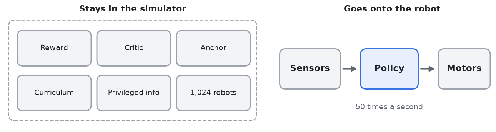

# Chapter 7. Onto the robot, and beyond

We've got a robot that walks, climbs and gets back up again. To finish off, we'll have a look at what actually ends up on the robot once the
training's all done, and then share a few closing thoughts.

## Packing for the trip

A lot of what we've talked about never leaves the simulator. There's the reward, the critic, the anchor, the curriculum, and all of the
privileged information. Those are only there to help with the learning, so once that's done we can leave them behind.

What's left is just the policy. Fifty times a second, the robot reads its sensors, runs them through the network, and sends the
result to the motors. On the Mini Pupper v4 with a Raspberry Pi, SKU2, that happens right there on the Pi.

*What stays behind, and what comes along.*

So does it walk like it did in the simulator? Pretty much, only a bit slower. When walking straight ahead, backwards or sideways, the
released walker got to somewhere around 70 to 90 percent of its simulated speed. You can find the details on the
[walker's page](https://github.com/mangdangroboticsclub/mini_pupper_4_rl/blob/64021d25e2c31798e64d59916ecb94ed6aa60041/mp4_rl/skills/walker/README.md).

> **What if there's no room for it?**
>
> There's also a smaller version of the Mini Pupper v4, SKU1, that doesn't have a Raspberry Pi, so the policy has to run on a microcontroller,
> a little chip with only a fraction of the computing power. When we first tried it, it was too slow. Most of the time was going on
> fetching the network's weights from the chip's slow external memory.
>
> Luckily, there's a well-known trick for this, called **quantisation**. If you're doing a sum by hand, you might use 3.14 for pi
> instead of 3.14159265, because there's a lot less to write and the answer comes out nearly the same. We did much the same to the
> network, by storing each of its weights in 16 bits instead of 32. With half as much to fetch, the walker ran fast enough, and the
> difference it made to the joint angles was less than a hundredth of a degree.

## Before you go

It'd be easy to read all this and think that each problem should have been obvious. Most of them weren't, at least not to us. You can plan as
carefully as you like, and some things will only show up once you've trained the policy, watched what it does, and wondered why
on earth it's doing that.

There's still a lot of trial and error in reinforcement learning. As far as we know, there's no single recipe that's guaranteed to give
you the behaviour that you're after. What worked for us was shaped by this robot and the things we wanted it to do, so it may not work as
well for yours. A different robot or a different task might call for a different approach altogether. But we hope that some of the ideas
will come in handy, or at least that you'll know you're not alone when your robot learns to fall over on purpose.

It's also good to keep in mind that reinforcement learning is only one of the ways for a robot to learn. It's a field that's moving
very quickly, with things like vision-language-action models (VLAs), which go from camera images and written or spoken instructions to
robot actions, and "System 1" decision models, which look at a situation and choose between the options very quickly. If that sounds
interesting, [Helix](https://figure.ai/news/helix), [GR00T N1](https://arxiv.org/abs/2503.14734) and
[StartLux-Decision](https://github.com/StartLuxLabs/StartLux-Decision) are good places to look.

## Where to go from here

All of the code is public, if you'd like to have a look around:

- [mini_pupper_4_rl](https://github.com/mangdangroboticsclub/mini_pupper_4_rl/tree/64021d25e2c31798e64d59916ecb94ed6aa60041) has the walker and
  the get-up, along with the training code and the recipes that go with them. You should recognise quite a lot in there by now. To train
  anything yourself, you'll need a computer with an NVIDIA graphics card.
- [mini_pupper_4_sim](https://github.com/mangdangroboticsclub/mini_pupper_4_sim/tree/775bf06be9dcfcaf679d72aed88797bee606c165) is the simulated
  robot, including the motor model from Chapter 2.
- [md300-bam-rig](https://github.com/mangdangroboticsclub/md300-bam-rig/tree/4f7835d5545647be8233ba90156fbd0482905e0f) is the test bench
  that we used to measure the motors.

And if you'd like to learn more about reinforcement learning itself:

- [Spinning Up in Deep RL](https://spinningup.openai.com/en/latest/) will take you from the basics through to how PPO works.
- The [Hugging Face Deep RL Course](https://huggingface.co/learn/deep-rl-course/unit0/introduction) is free and hands-on.
- The Stable-Baselines3 [tips and tricks](https://stable-baselines3.readthedocs.io/en/master/guide/rl_tips.html) page is short and practical,
  and some of it will probably sound familiar.
- [How to Train Your Robot with Deep Reinforcement Learning](https://arxiv.org/abs/2102.02915) is another team's account of the sort of
  problems they ran into on real robots.

Thanks for reading, and good luck with your own robot!
