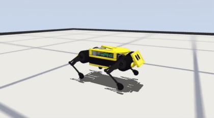
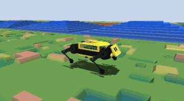
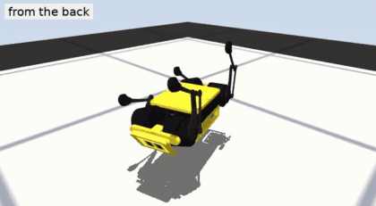

# Teaching a small robot dog to walk

In this tutorial we're going to look at how a small robot dog, the Mini Pupper v4, learned to walk. Not just forward
on a nice flat floor, but in every direction, over uneven ground, and, when all that goes wrong, how to get back up
again. All of it was done with reinforcement learning, where instead of programming each movement we let the robot
figure it out by trial and error.

You don't need to know anything about reinforcement learning to follow along, or much about robotics either. We'll
introduce each idea when the story needs it.

Now, there are plenty of great courses out there that teach the theory properly, and this isn't trying to be one of
them. It's also not a guide to running our code, so there's nothing to install and no maths to work through. What
we'd like to share is the *why*: what we tried, what went wrong along the way (quite a lot!), and how that shaped the
policies we ended up with.

Hopefully by the end you'll have a feel for what it's like to train a robot, and if you go on to try it yourself,
you might recognise some of these problems when they turn up in your own project.

| | | |
|---|---|---|
|  |  |  |

*Walking, crossing rough ground and getting up, all in simulation.*

## Chapters

0. [What is reinforcement learning?](00_meet_the_robot.md)
1. [A head start](01_a_head_start.md): why we did not start from nothing
2. [The simulator lies a little](02_the_simulator_lies_a_little.md): training in one world, walking in another
3. [You get what you reward](03_you_get_what_you_reward.md): robots that learned to fall over
4. [One step at a time](04_one_step_at_a_time.md): uneven ground and stairs
5. [Learning without forgetting](05_learning_without_forgetting.md): new skills, old skills
6. [Getting back up](06_getting_back_up.md): shoves, falls and a backwards flip
7. [Onto the robot, and beyond](07_onto_the_robot.md): what ends up on the robot, and where to go next
